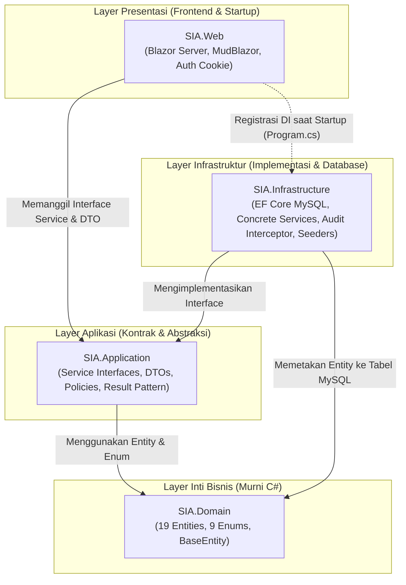
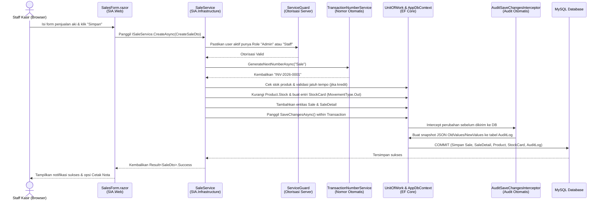

# SIA — Sistem Informasi Akuntansi Toko Aki/Baterai Kendaraan

Proyek *capstone* **Sistem Informasi Akuntansi (SIA)** berbasis web untuk UMKM toko aki/baterai kendaraan yang dibangun menggunakan **.NET 8**, **Blazor Web App (Interactive Server)**, **MudBlazor**, **Entity Framework Core (MySQL/Pomelo)**, dan **ASP.NET Core Identity** dengan pendekatan **Clean Architecture**.

Dokumen ini disusun sebagai panduan utama bagi **anggota tim pengembang** (untuk memahami ekosistem .NET dan alur kode dengan cepat) serta **dosen pembimbing/penguji** (untuk meninjau keputusan arsitektur, aturan bisnis akuntansi, keamanan, dan strategi pengujian).

---

## Daftar Isi

1. [Gambaran Umum & Konteks Bisnis](#1-gambaran-umum--konteks-bisnis)
2. [Mengenal Ekosistem Framework .NET 8 di Proyek Ini (Kamus Istilah)](#2-mengenal-ekosistem-framework-net-8-di-proyek-ini-kamus-istilah)
3. [Arsitektur Proyek: Clean Architecture (Analogi & Teknis)](#3-arsitektur-proyek-clean-architecture-analogi--teknis)
4. [Visualisasi "Perjalanan Satu Transaksi" (Life of a Request)](#4-visualisasi-perjalanan-satu-transaksi-life-of-a-request)
5. [Aturan Bisnis Kunci & Keputusan Desain](#5-aturan-bisnis-kunci--keputusan-desain)
6. [Strategi Pengujian (Testing Strategy)](#6-strategi-pengujian-testing-strategy)
7. [Panduan Setup & Cara Menjalankan Proyek dari Nol](#7-panduan-setup--cara-menjalankan-proyek-dari-nol)
8. [Referensi Dokumentasi Proyek](#8-referensi-dokumentasi-proyek)

---

## 1. Gambaran Umum & Konteks Bisnis

Aplikasi ini dirancang khusus untuk memenuhi kebutuhan operasional dan akuntansi **UMKM Toko Aki/Baterai Kendaraan** (mobil & motor). Berbeda dengan sistem ritel pakaian atau toko kelontong biasa, produk di sistem ini memiliki atribut teknis spesifik baterai kendaraan (**Merek/Brand**, **Tipe Aki**: *Basah, Kering/MF, AGM, GEL*, **Tegangan/Voltage**, dan **Kapasitas/Ampere-Hour (Ah)**).

### Ringkasan Konteks Bisnis

| Aspek | Ketentuan Sistem |
|---|---|
| **Skala Usaha** | UMKM (2–5 staf operasional, 10–50 transaksi/hari, omzet Rp 300 juta – Rp 2,5 miliar/tahun) |
| **Mata Uang & Format** | Rupiah (`IDR`) tunggal, kultur `id-ID` (`Rp 1.250.000`), tipe data `decimal` presisi tinggi |
| **Pajak (PPN)** | Tidak menggunakan PPN (omzet UMKM di bawah batas PKP Rp 4,8 miliar) |
| **Pencatatan Stok** | **Otomatis** berubah saat penjualan, penerimaan PO, retur penjualan, dan retur pembelian + wajib mencatat **Kartu Stok (`StockCard`)** |
| **Jurnal Umum** | **Diinput manual** oleh akuntan/pemilik (sistem **tidak** memposting jurnal otomatis dari transaksi operasional) |
| **Piutang & Utang** | Mendukung transaksi tunai maupun kredit (dengan tanggal jatuh tempo `DueDate` dan cicilan bertahap) |
| **Persetujuan Pembelian** | Menggunakan alur *Purchase Order (PO)* bertahap: `Draft` → `Approved` (khusus Admin) → `Received` / `Cancelled` |
| **Peran Pengguna (Role)** | **Admin** (Pemilik Toko), **Staff** (Kasir/Karyawan Gudang), **Viewer** (Akuntan/Pemeriksa Laporan) |

---

## 2. Mengenal Ekosistem Framework .NET 8 di Proyek Ini (Kamus Istilah)

Bagi anggota tim yang baru beralih dari bahasa/framework lain (seperti PHP/Laravel, JavaScript/Node.js, atau Python), berikut adalah penjelasan konsep inti ekosistem **.NET 8** yang digunakan di proyek ini:

| Istilah / Teknologi | Analogi Sederhana | Peran Teknis di Proyek SIA |
|---|---|---|
| **.NET 8 SDK & C#** | Mesin utama & bahasa komunikasi | Fondasi eksekusi kode yang dikompilasi secara *strongly-typed* (kesalahan tipe data langsung tertangkap saat `dotnet build`, bukan saat aplikasi sudah berjalan). Versi SDK dikunci di `global.json`. |
| **Solution (`SIA.sln`)** | **Lemari Arsip Utama** | File wadah tertinggi yang menyatukan seluruh bagian proyek (`Domain`, `Application`, `Infrastructure`, `Web`, dan `Tests`) agar bisa di-build dan diuji secara bersamaan. |
| **Project (`.csproj`)** | **Map Folder di dalam Lemari** | Setiap lapisan arsitektur adalah satu proyek `.csproj` mandiri yang memiliki daftar pustaka (*NuGet packages*) dan aturan aksesnya masing-masing. |
| **Blazor Web App (Interactive Server)** | **Layar Interaktif Tanpa Terpisah Frontend-Backend** | Teknologi UI dari Microsoft yang memungkinkan pembuatan antarmuka web dinamis menggunakan **C# dan HTML (`.razor`)** tanpa perlu membangun proyek React/Vue/REST API terpisah. Interaksi tombol pengguna dikirim secara *real-time* ke server melalui koneksi WebSocket (**SignalR Circuit**). |
| **MudBlazor** | **Kotak Peralatan Komponen Visual** | Pustaka komponen UI berbasis *Material Design* untuk Blazor (Tabel, Dialog, Form Input, DatePicker, Snackbar/Notifikasi). Seluruh warna diatur satu pintu lewat `SiaTheme.cs`. |
| **Entity Framework Core (EF Core) + Pomelo MySQL** | **Penerjemah Otomatis C# ↔ Database SQL** | *Object-Relational Mapper (ORM)* yang menerjemahkan class C# (seperti `Product`, `Sale`) menjadi tabel di MySQL, dan mengubah perintah C# LINQ menjadi query SQL yang aman dari *SQL Injection*. |
| **EF Core Migrations** | **Mesin Waktu Skema Database** | Fitur yang merekam perubahan struktur class C# menjadi skrip pembuatan tabel database (`src/SIA.Infrastructure/Data/Migrations/`), sehingga seluruh anggota tim memiliki struktur tabel MySQL yang 100% identik tanpa impor file `.sql` manual. |
| **ASP.NET Core Identity** | **Petugas Keamanan & Kartu Akses** | Sistem bawaan .NET yang mengelola tabel pengguna (`ApplicationUser`), enkripsi/hashing password, sesi login cookie, penguncian akun (*lockout* setelah 5x salah password), serta pembagian hak akses **Role & Policy**. |
| **Dependency Injection (DI)** | **Asisten Penyedia Alat Otomatis** | Saat sebuah halaman membutuhkan layanan (misal `ISaleService`), halaman tersebut tidak membuat objeknya sendiri (`new SaleService()`), melainkan "meminta" ke sistem DI yang sudah didaftarkan di `DependencyInjection.cs` dan `Program.cs`. |
| **DTO (*Data Transfer Object*) & `Result<T>`** | **Kotak Paket Pengiriman Standar** | Objek khusus di `SIA.Application/DTOs/` untuk membawa data dari layar UI ke Service dan sebaliknya. Hasil operasi dibungkus dalam `Result<T>` (berisi status `IsSuccess`, `Value`, atau pesan `Error`) agar penanganan pesan kesalahan konsisten. |
| **`dotnet user-secrets`** | **Brankas Rahasia Lokal** | Tempat penyimpanan konfigurasi sensitif (seperti password database MySQL) di komputer masing-masing developer agar **tidak pernah ikut ter-upload (commit) ke GitHub**. |

---

## 3. Arsitektur Proyek: Clean Architecture (Analogi & Teknis)

Proyek ini menerapkan **Clean Architecture** yang membagi kode ke dalam **4 lapisan proyek utama** di dalam folder `src/` dan **1 proyek pengujian** di dalam folder `tests/`.

### Analogi Praktis: "Bagaimana Sebuah Restoran Bekerja"

Bayangkan aplikasi ini seperti sebuah **Restoran Modern**:

1. **`SIA.Domain` (Bahan Baku & Resep Inti)**
   Berisi definisi objek bisnis paling murni: apa itu `Product` (Aki), `Sale` (Penjualan), `JournalEntry` (Jurnal Umum), beserta enum statusnya. Lapisan ini **tidak tahu-menahu** apakah aplikasi ini ditampilkan di web, mobile, atau disimpan di database MySQL/SQLite.
2. **`SIA.Application` (Buku Menu & Standar Operasional/SOP)**
   Berisi **kontrak layanan (`Interface`)** dan **paket data (`DTO`)**. Misalnya: *"Sistem harus punya layanan `ISaleService` yang menerima `CreateSaleDto` dan mengembalikan nomor faktur"*. Lapisan ini hanya mendefinisikan **apa** yang bisa dilakukan sistem, belum mengatur **bagaimana** query databasenya.
3. **`SIA.Infrastructure` (Dapur & Gudang Penyimpanan)**
   Di sinilah semua "pekerjaan dapur" sesungguhnya dilakukan: implementasi logika bisnis (`SaleService`, `JournalService`, dll.), koneksi ke database MySQL lewat `AppDbContext`, pencatatan `AuditLog` otomatis, dan penyimpanan data.
4. **`SIA.Web` (Ruang Makan & Pelayan / Antarmuka Pengguna)**
   Bagian yang dilihat dan disentuh pengguna di browser (file `.razor`). Tugasnya hanya menampilkan data ke layar, menerima input dari form kasir/admin, lalu meneruskannya ke layanan di `SIA.Application`. **Pelayan (`SIA.Web`) dilarang keras masuk langsung ke gudang database (`AppDbContext`)!**

### Diagram Arsitektur & Arah Dependensi

Aturan emas di proyek ini adalah: **Arah ketergantungan (dependency) bergerak ke arah dalam menuju `SIA.Domain`**.



> [!IMPORTANT]
> **Aturan Ketat Arsitektur:**
> - `SIA.Domain` **tidak memiliki dependensi** ke proyek atau paket eksternal apa pun.
> - `SIA.Web` **tidak boleh** memanggil `AppDbContext` secara langsung. Seluruh operasi baca/tulis data dari halaman Blazor wajib melewati interface service di `SIA.Application` (contoh: `ISaleService`, `IJournalService`, `IAccountService`).

### Peta Struktur Folder Lengkap

```text
c:\Accounting Project\
├── src/
│   ├── SIA.Domain/                        # LAYER 1: Inti Bisnis (Tanpa dependensi luar)
│   │   ├── Common/BaseEntity.cs           # Class induk (Id int, CreatedAt, UpdatedAt, IsDeleted)
│   │   ├── Entities/                      # 19 Entitas database (Accounting, Sales, Purchasing, Inventory, Payments, System)
│   │   └── Enums/                         # 9 Enum (AccountCategory, BatteryType, PaymentStatus, PurchaseOrderStatus, dll.)
│   │
│   ├── SIA.Application/                   # LAYER 2: Kontrak Aplikasi & DTO
│   │   ├── Common/
│   │   │   ├── Constants/                 # Roles.cs, Policies.cs, TransactionTypes.cs
│   │   │   ├── Interfaces/                # IRepository, IUnitOfWork, ICurrentUserService, IAuditService
│   │   │   └── Models/Result.cs           # Wrapper hasil eksekusi (Success / Failure)
│   │   ├── DTOs/                          # Data Transfer Objects per modul
│   │   └── Services/                      # 15 Interface layanan bisnis (ISaleService, IJournalService, dll.)
│   │
│   ├── SIA.Infrastructure/                # LAYER 3: Implementasi Layanan & Akses Database
│   │   ├── Data/
│   │   │   ├── AppDbContext.cs            # Konteks EF Core + Global Query Filter Soft Delete
│   │   │   ├── Configurations/            # Konfigurasi kolom, tipe decimal(18,2), relasi & index MySQL
│   │   │   ├── Interceptors/              # AuditSaveChangesInterceptor.cs (Rekam AuditLog otomatis)
│   │   │   ├── Migrations/                # Riwayat migrasi skema database MySQL
│   │   │   └── Seed/MasterDataSeeder.cs   # Seeding otomatis 21 Akun CoA & 6 Format Nomor Transaksi
│   │   ├── Identity/                      # ApplicationUser, IdentitySeeder (Role & Akun Uji)
│   │   ├── Repositories/                  # Implementasi Generic Repository<T> & UnitOfWork
│   │   ├── Services/                      # Implementasi konkret 15 service + ServiceGuard (Otorisasi server)
│   │   └── DependencyInjection.cs         # Pendaftaran seluruh layanan ke container DI .NET
│   │
│   └── SIA.Web/                           # LAYER 4: Antarmuka Pengguna (Blazor Server)
│       ├── Components/
│       │   ├── Layout/                    # MainLayout.razor, NavMenu.razor (Menu dinamis sesuai Role)
│       │   └── Pages/                     # Halaman UI per modul (Accounting, Sales, Purchasing, Inventory, Payments, Reporting, Admin, Auth)
│       ├── Formatting/Display.cs          # Helper format mata uang Rupiah (Rp) & tanggal Indonesia
│       ├── Security/                      # Pelacak identitas user aktif di Blazor Circuit
│       ├── Theme/                         # SiaColors.cs & SiaTheme.cs (Tema warna terpusat)
│       ├── wwwroot/css/print.css          # CSS khusus cetak struk/nota penjualan (@media print)
│       └── Program.cs                     # Titik masuk aplikasi (Startup, Middleware, Seeding)
│
├── tests/
│   └── SIA.Tests/                         # PROYEK PENGUJIAN OTOMATIS (xUnit + Moq + SQLite In-Memory)
│       ├── Domain/                        # Pengujian entitas dasar & enum
│       ├── Application/                   # Pengujian kebijakan otorisasi (Policies) & Result<T>
│       ├── Infrastructure/                # Pengujian AppDbContext, Soft Delete, Audit Interceptor, Seeder
│       ├── Services/                      # Unit & Integration test untuk seluruh 15 Service bisnis
│       ├── E2E/                           # Pengujian alur ujung-ke-ujung (Tier 1 s/d Tier 4 skenario nyata)
│       ├── Stress/                        # Pengujian beban laporan keuangan ribuan transaksi
│       └── Challenger/                    # Pengujian skenario ekstrem & keamanan otorisasi
│
├── docs/
│   └── implementation_plan.md             # Dokumen spesifikasi teknis & ERD lengkap
├── AGENTS.md                              # Aturan arsitektur & konvensi pengembangan proyek
├── global.json                            # Pengunci versi .NET SDK 8.0
└── SIA.sln                                # File Solution utama .NET
```

---

## 4. Visualisasi "Perjalanan Satu Transaksi" (Life of a Request)

Untuk memudahkan teman satu tim dan dosen memahami bagaimana keempat layer bekerja sama saat aplikasi digunakan, berikut adalah alur yang terjadi di balik layar ketika seorang **Staff Kasir** mengklik tombol **"Simpan Penjualan"** pada halaman `SalesForm.razor`:



### Mengapa Alur Ini Penting?
1. **Keamanan Berlapis (`ServiceGuard`)**: Meskipun tombol di UI disembunyikan untuk role tertentu, `SaleService` di sisi server tetap memeriksa ulang apakah pemanggil benar-benar memiliki izin (`Admin` atau `Staff`).
2. **Atomisitas Transaksi Database**: Pengurangan stok aki, pembuatan kartu stok (`StockCard`), penomoran faktur (`INV-YYYY-XXXX`), dan penyimpanan nota penjualan terjadi dalam **satu transaksi database**. Jika salah satu gagal (misal stok tiba-tiba tidak cukup), seluruh proses dibatalkan (*rollback*) sehingga data tidak pernah timpang.
3. **Jejak Audit TanpaTerlewat (`AuditSaveChangesInterceptor`)**: Programmer tidak perlu menulis kode log manual di setiap fungsi; setiap perubahan data otomatis terekam lengkap dengan ID pengguna, waktu, nilai lama, dan nilai baru dalam format JSON.

---

## 5. Aturan Bisnis Kunci & Keputusan Desain

Bagian ini merangkum aturan domain akuntansi dan operasional yang diterapkan di dalam kode (sangat berguna sebagai bahan penjelasan saat presentasi atau sidang dengan dosen):

### 5.1. Jurnal Umum Manual vs Pergerakan Stok Otomatis
- **Stok Bergerak Otomatis**: Setiap transaksi operasional langsung mengubah jumlah stok produk (`Product.Stock`) dan wajib mencatat riwayat di **Kartu Stok (`StockCard`)**:
  - Penjualan (`Sale`) → Stok keluar (`StockMovementType.Out`).
  - Pembelian (`PurchaseOrder`) saat berstatus **Received** → Stok masuk (`StockMovementType.In`).
  - Retur Penjualan (`SaleReturn`) → Barang kembali ke gudang (`StockMovementType.ReturnIn`).
  - Retur Pembelian (`PurchaseReturn`) → Barang dikembalikan ke pemasok (`StockMovementType.ReturnOut`).
- **Jurnal Umum Diinput Manual**: Sesuai spesifikasi bisnis proyek ini, transaksi penjualan, pembelian, dan pembayaran **tidak** memposting jurnal umum secara otomatis. Pencatatan akuntansi dilakukan secara sadar (*deliberate*) melalui modul **Jurnal Umum (`JournalEntries`)** dengan validasi ketat prinsip *Double-Entry Bookkeeping*:
  $$\sum \text{Debit} = \sum \text{Kredit} > 0$$
- **Konsistensi Saldo Akun & Fitur Rekalkulasi**: Setiap kali jurnal diposting, properti `Account.Balance` langsung diperbarui sesuai saldo normal akun (`NormalBalance.Debit` atau `Credit`). Sebagai jaring pengaman (*safety net*), tersedia fitur **Rekalkulasi Saldo** di `IAccountService` untuk menghitung ulang seluruh saldo akun dari `SUM(JournalEntryLine)` kapan saja.

### 5.2. Alur Persetujuan Purchase Order (PO)
Untuk mencegah pembelian stok aki tanpa sepengetahuan pemilik toko, pemesanan barang ke pemasok melalui 3 tahap ketat:
1. **`Draft`**: Dibuat oleh `Staff` atau `Admin` (stok belum bertambah).
2. **`Approved` / `Cancelled`**: Hanya **`Admin` (Pemilik Toko)** yang dapat menyetujui (`Approve`) atau membatalkan PO.
3. **`Received`**: Saat barang fisik tiba di toko dan PO ditandai diterima, barulah stok produk bertambah secara otomatis dan `StockCard` tercatat.

### 5.3. Pembayaran Polimorfik & Pelacakan Piutang/Utang
- Tabel `Payment` menggunakan desain **Polimorfik** melalui kombinasi kolom `ReferenceType` (`Sale` atau `PurchaseOrder`) dan `ReferenceId` (ID transaksi terkait) dengan validasi integritas penuh di `PaymentService`.
- Mendukung pembayaran **Tunai (Lunas langsung)** maupun **Kredit / Cicilan Bertahap**:
  - Setiap transaksi kredit wajib mencantumkan tanggal jatuh tempo (`DueDate`).
  - Setiap kali pembayaran dicatat di `PaymentService`, sistem otomatis menghitung ulang `PaidAmount` (jumlah terbayar), `RemainingAmount` (sisa tagihan), dan memperbarui `PaymentStatus` menjadi `Unpaid`, `PartiallyPaid` (cicilan sebagian), atau `Paid` (lunas).

### 5.4. Soft Delete & Penomoran Transaksi Otomatis
- **Soft Delete Global**: Tidak ada data master atau transaksi yang dihapus secara fisik (`DELETE FROM`) dari database. Penghapusan mengubah flag `IsDeleted = true` dan mengisi `DeletedAt`. EF Core *Global Query Filter* di `AppDbContext` secara otomatis menyembunyikan baris yang telah dihapus dari query normal.
- **Penomoran Otomatis Reset Tahunan**: Seluruh nomor dokumen dibuat oleh `ITransactionNumberService` dengan format `{Prefix}-{Year}-{Seq:0000}` (contoh: `INV-2026-0001`, `PO-2026-0001`, `JRN-2026-0001`, `PAY-2026-0001`, `SRT-2026-0001`, `PRT-2026-0001`) dan nomor urut akan kembali ke `0001` saat berganti tahun.

### 5.5. Matriks Hak Akses (Role-Based & Policy Authorization)
Otorisasi ditegakkan di dua sisi: penyembunyian menu di UI Blazor (`NavMenu.razor`) **dan** pemeriksaan paksa di lapisan service server (`ServiceGuard.cs`).

| Modul / Fitur | Admin (Pemilik) | Staff (Kasir/Gudang) | Viewer (Akuntan) |
|---|:---:|:---:|:---:|
| **Dashboard & Ringkasan** | ✅ | ✅ | ✅ |
| **Penjualan, Retur Penjualan & Cetak Nota** | ✅ (Penuh) | ✅ (Penuh) | 👁️ (Lihat Saja) |
| **Pelanggan & Pemasok (Customer/Supplier)** | ✅ (Penuh) | ✅ (Penuh) | 👁️ (Lihat Saja) |
| **Purchase Order (Buat Draft & Terima Barang)** | ✅ | ✅ | 👁️ (Lihat Saja) |
| **Approve / Cancel Purchase Order** | ✅ (**Khusus Admin**) | ❌ | ❌ |
| **Inventori Produk Aki & Kartu Stok** | ✅ (Penuh) | ✅ (Penuh) | 👁️ (Lihat Saja) |
| **Pembayaran Piutang / Utang** | ✅ (Penuh) | ✅ (Penuh) | 👁️ (Lihat Saja) |
| **Bagan Akun (Chart of Accounts)** | ✅ (Kelola & Rekalkulasi) | ❌ | 👁️ (Lihat Saja) |
| **Jurnal Umum Manual (`JournalEntries`)** | ✅ (Input & Lihat) | ❌ | ✅ (Input & Lihat) |
| **Laporan Keuangan (Neraca, Laba Rugi, Arus Kas)** | ✅ (Lihat & Cetak) | ❌ | ✅ (Lihat & Cetak) |
| **Manajemen User, Format Nomor & Audit Log** | ✅ (**Khusus Admin**) | ❌ | ❌ |

---

## 6. Strategi Pengujian (Testing Strategy)

Proyek ini dilengkapi rangkaian pengujian otomatis komprehensif di dalam proyek `tests/SIA.Tests` untuk memastikan keandalan perhitungan akuntansi dan aturan bisnis tanpa merusak database MySQL produksi:

- **Framework Pengujian**: Menggunakan **xUnit** sebagai test runner, **Moq** untuk melakukan *mocking* dependensi, dan **SQLite In-Memory Database** (`SqliteTestDatabase.cs`) untuk menguji query EF Core, transaksi, interceptor audit, dan filter *soft delete* secara nyata di memori.
- **Lapisan Pengujian yang Tersedia**:
  1. **Unit Tests (`Domain/` & `Application/`)**: Menguji properti `BaseEntity`, kelengkapan nilai `Enum`, pemetaan `Policies`, dan objek `Result<T>`.
  2. **Service & Infrastructure Tests (`Infrastructure/` & `Services/`)**: Menguji seluruh 15 layanan bisnis (validasi jurnal tidak seimbang, kalkulasi saldo akun, pemotongan stok penjualan, alur status PO, pelunasan parsial piutang/utang, dan pembuatan `AuditLog`).
  3. **End-to-End (E2E) Tiered Tests (`E2E/`)**:
     - *Tier 1*: Cakupan fitur dasar per modul.
     - *Tier 2*: Kasus batas (*boundary & corner cases*, seperti stok nol, pembayaran melebihi sisa tagihan, duplikasi kode akun).
     - *Tier 3*: Kombinasi lintas fitur (pembelian → penerimaan barang → penjualan → retur → pelunasan).
     - *Tier 4*: Simulasi skenario operasional toko aki dunia nyata dari awal buka toko hingga cetak laporan keuangan akhir periode.
  4. **Stress & Challenger Tests (`Stress/` & `Challenger/`)**: Menguji performa pembuatan laporan keuangan pada volume data besar serta pengujian ketahanan otorisasi terhadap akses ilegal antar-role.

---

## 7. Panduan Setup & Cara Menjalankan Proyek dari Nol

Ikuti langkah-langkah berikut secara berurutan agar aplikasi dapat berjalan dengan lancar di komputer lokal Anda:

### 7.1. Prasyarat Sistem
1. **.NET 8.0 SDK** telah terinstal (cek dengan perintah `dotnet --version`). Versi SDK dikunci otomatis oleh file `global.json`.
2. **MySQL Server 8.x** berjalan di lokal (misalnya melalui MySQL Community Server, Laragon, atau XAMPP).
3. *(Opsional)* Alat CLI Entity Framework Core jika ingin menjalankan perintah migrasi manual:
   ```powershell
   dotnet tool install --global dotnet-ef --version 8.*
   ```

### 7.2. Konfigurasi Rahasia Lokal (`dotnet user-secrets`)
Demi keamanan, **connection string database dan password akun uji tidak disimpan di dalam `appsettings.json`**. Atur konfigurasi lokal Anda sekali saja melalui terminal PowerShell di folder root proyek:

```powershell
# 1. Atur connection string MySQL Anda (sesuaikan User dan Password MySQL lokal Anda)
dotnet user-secrets set "ConnectionStrings:DefaultConnection" "Server=localhost;Port=3306;Database=sia_db;User=root;Password=PASSWORD_MYSQL_ANDA;" --project src/SIA.Web

# 2. Atur password default untuk men-seed 3 akun uji otomatis di mode Development
#    (Wajib minimal 8 karakter, mengandung huruf besar, huruf kecil, dan angka)
dotnet user-secrets set "Seed:DefaultPassword" "SiaTest123" --project src/SIA.Web
```

### 7.3. Menjalankan Migrasi Database MySQL
Buat database dan seluruh 19 tabel beserta indeksnya secara otomatis ke MySQL Anda dengan menjalankan perintah berikut:

```powershell
# Set environment variable sementara untuk tool EF CLI (sesuaikan password MySQL Anda)
$env:ConnectionStrings__DefaultConnection="Server=localhost;Port=3306;Database=sia_db;User=root;Password=PASSWORD_MYSQL_ANDA;"

# Terapkan migrasi skema database ke MySQL
dotnet ef database update --project src/SIA.Infrastructure --startup-project src/SIA.Web
```

### 7.4. Build, Jalankan Pengujian, dan Nyalakan Aplikasi

```powershell
# 1. Kompilasi seluruh proyek di dalam solution
dotnet build SIA.sln

# 2. Jalankan seluruh pengujian otomatis (menggunakan SQLite In-Memory, tidak memerlukan MySQL aktif)
dotnet test SIA.sln

# 3. Jalankan aplikasi web Blazor Server
dotnet run --project src/SIA.Web
```

Setelah `dotnet run --project src/SIA.Web` berjalan, buka URL lokal yang muncul di terminal (biasanya `http://localhost:5000` atau `https://localhost:5001`) melalui browser.

### 7.5. Data Awal Otomatis (Seeding) & Akun Uji Login
Saat aplikasi pertama kali dinyalakan (`Program.cs`), sistem secara otomatis menjalankan *idempotent seeding*:
1. **Master Data**: Membuat **21 akun standar *Chart of Accounts* (CoA)** toko aki (Kas, Bank, Piutang Usaha, Persediaan Barang Dagang Aki, Utang Usaha, Modal, Penjualan, HPP, Beban-beban) dan **6 konfigurasi nomor transaksi** (`INV`, `PO`, `JRN`, `PAY`, `SRT`, `PRT`).
2. **Role & Akun Uji (Khusus Mode Development)**: Jika `Seed:DefaultPassword` telah diatur pada langkah 7.2, Anda dapat langsung login menggunakan salah satu dari 3 akun berikut:

| Role | Email Login | Password | Kegunaan Pengujian |
|---|---|---|---|
| **Admin** | `admin@sia.local` | *(Sesuai `Seed:DefaultPassword`, misal: `SiaTest123`)* | Akses penuh semua menu, approve PO, kelola user, lihat audit log |
| **Staff** | `staff@sia.local` | *(Sesuai `Seed:DefaultPassword`, misal: `SiaTest123`)* | Simulasi kasir & staf gudang (input penjualan, buat draft PO, stok, pembayaran) |
| **Viewer** | `viewer@sia.local` | *(Sesuai `Seed:DefaultPassword`, misal: `SiaTest123`)* | Simulasi akuntan (input jurnal umum manual, lihat & cetak laporan keuangan) |

---

## 8. Referensi Dokumentasi Proyek

- **Rencana Implementasi & Spesifikasi Teknis Lengkap (ERD, Daftar Entitas, dan Riwayat Revisi)**: [docs/implementation_plan.md](docs/implementation_plan.md)
- **Aturan Arsitektur, Konvensi Kode, & Panduan Kolaborasi**: [AGENTS.md](AGENTS.md)
